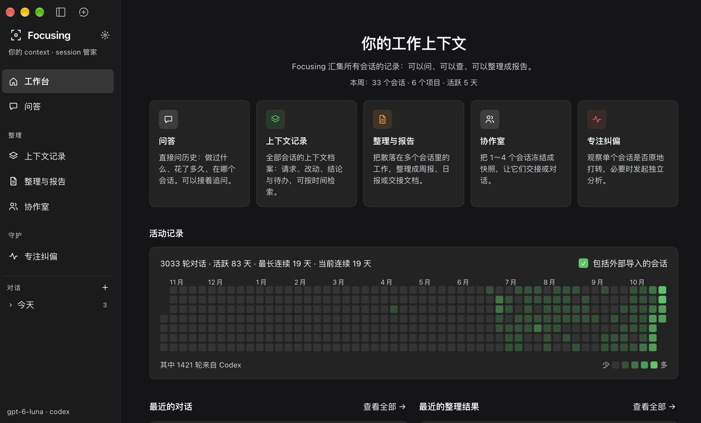
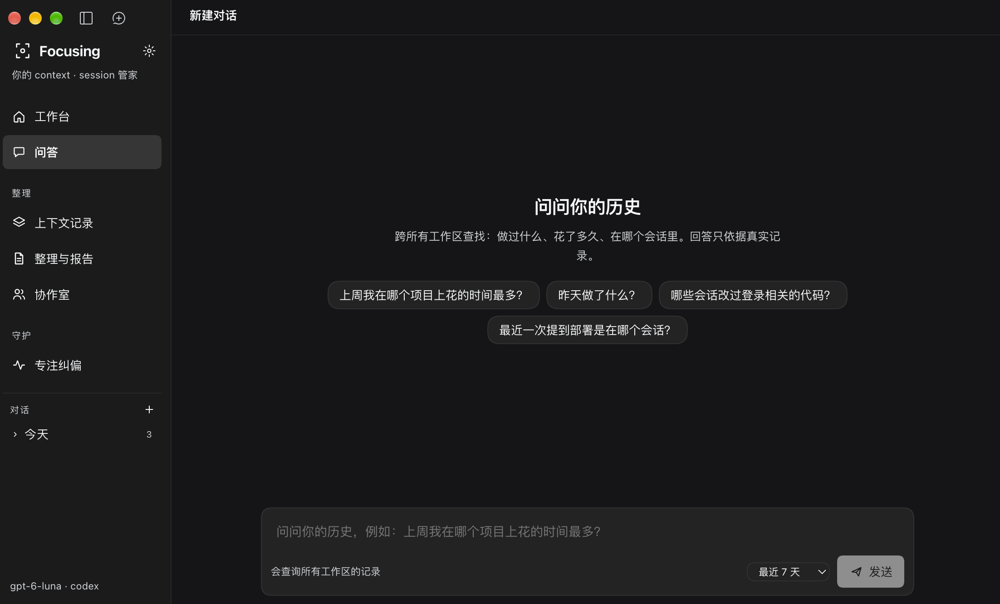
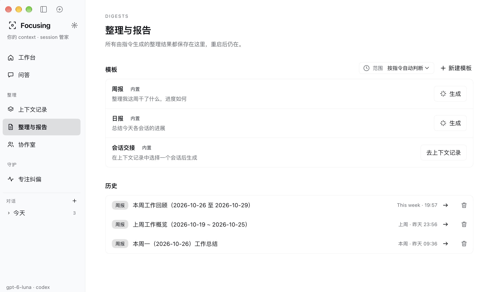
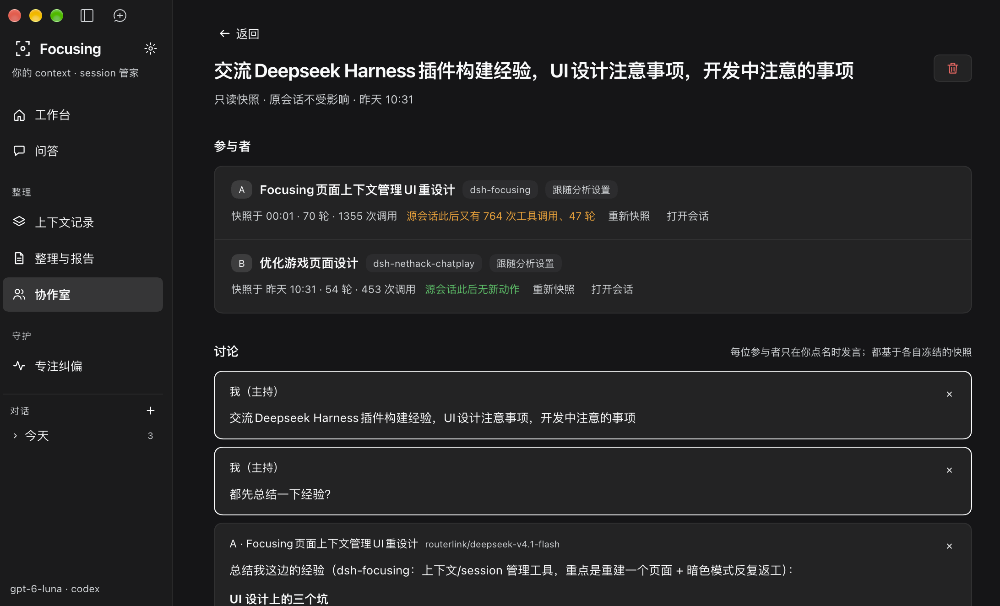

# Focusing

[](https://www.npmjs.com/package/dsh-focusing) [](https://github.com/topics/dsh-plugin)

**你的 context · session 管家。**

Focusing 是 DeepSeek Harness（DSH）的上下文工作台，把 DSH 会话和本机 Codex 记录汇集起来：查找过去的工作、整理日报与交接、让不同会话的经验参与讨论，以及观察 Agent 是否陷入重复尝试。

> [!WARNING]
> **当前处于可能包含破坏性变更的早期更新阶段。** 配置格式、存储结构、页面行为及插件接口可能在后续版本中不兼容地调整，功能稳定性尚未经过充分确认。请勿直接用于关键生产数据；升级前请备份插件数据，并在测试环境验证。当前版本已在 DSH `0.2.1-rc.3` 上开发和测试，其他版本尚未确认兼容性。

## 0.1.0 更新

- 上下文记录按工作区和 DSH/Codex 来源浏览；DSH 会话可复制上下文继续，Codex 记录可在同一工作目录开启 DSH 会话。
- 活动日历与上下文记录使用持久索引，未变更的会话可在重启后复用整理结果。
- 周报、日报与会话交接模板要求写明改动、结果、验证证据和遗留问题；生成提示词鼓励完整说明，避免只有会话标题或笼统结论。

## 从哪里开始

| 你想做什么 | 打开哪个页面 |
|---|---|
| 看最近在做哪些项目、回到已有问答或报告 | **工作台** |
| 问“上周做了什么”“某个问题最后怎么解决的” | **问答** |
| 按工作区和来源浏览会话，接着之前的上下文继续 | **上下文记录** |
| 生成周报、日报，保存自己的报告模板 | **整理与报告** |
| 对照几个会话的经验，讨论后生成交接简报 | **协作室** |
| 检查一个会话是否原地打转、查看分析记录 | **专注纠偏** |

## 工作台：先看全局，再进入具体工作



首页是导览，集中展示五个能力入口、本周会话与项目概览、活动日历，以及最近的问答和整理结果。点击卡片进入对应页面，点击最近记录继续之前的工作。

活动日历每格代表一天，颜色深浅表示对话轮次。总轮次、活跃天数和连续活跃情况由日志计算；开启“包括外部导入的会话”后可计入 Codex，并显示其贡献。上方的本周概览与日历可能覆盖不同时间窗口。

截图中的计数是示例数据。对话轮次、工具调用量反映活动量，不能直接换算成实际工时或生产力评分。

## 问答：找到历史，再接着问



在独立问答页直接输入问题，例如：

- “昨天做了什么？”
- “哪些会话改过登录相关的代码？”
- “最近一次提到部署是在哪个会话？”
- “比较两个项目处理 UI 问题的经验。”

模型先查找会话，再按需读取内容和活动统计。查询过程折叠展示，展开可以查看调用及输出；继续追问会沿用当前问答的上下文。

**先选搜索范围。** 输入框提供“最近 7 天”“最近 30 天”和“全部记录”，默认最近 30 天。查询覆盖所有工作区，但新读取的记录受所选时间窗口约束，Host 会校验这个边界。截图选择的是最近 7 天；需要查更早的工作时先扩大范围。同一问答已有的消息仍保留在上下文中。

对话内容居中，输入框固定在底部。左侧“对话”按今天、昨天、更早分组，可折叠、展开更多记录，或点击 `+` 新建。窄布局下改用页内下拉框切换。

问答支持停止、删除和本地保存。离开页面不会中断正在进行的查询；Host 重启时未完成的回合会标记为中断。历史问答保留最多 300 个。

## 整理与报告：把工作变成可复用的文档



报告页将**模板**和**历史结果**放在一起。先选择模板与时间范围，再点击“生成”；完成后从历史列表打开、复制 Markdown、下载、追问或重新生成。

| 模板 | 产出 | 使用方式 |
|---|---|---|
| 周报 | 本周主线、各项目实际改动与验证、遗留问题、优先级明确的下一步 | 直接生成，默认本周范围 |
| 日报 | 今日成果、进行中与阻塞事项、关键文件与验证、明日优先事项 | 直接生成，默认今天范围 |
| 会话交接 | 背景与目标、完成结果、决策原因、关键文件作用、验证证据、风险和接手步骤 | 前往上下文记录，选中具体会话后生成 |
| 自定义模板 | 由自己的指令定义整理重点 | 保存名称、指令与默认范围，可编辑或删除 |

内置模板只读。自定义模板保存的是整理指令和范围，复用同一条报告生成链路。报告可展示摘要、按项目进展、按天回顾、下一步和来源会话；其中数字由程序统计，描述与建议由模型归纳。

**问答用于逐步查证，报告用于集中归纳。** 报告先由插件筛选和压缩记录，再调用模型一次生成结构化结果；报告追问则重新读取原报告涉及的会话材料。模型不可用或输出无法解析时，可以返回标明原因的结构草稿；数据读取失败会显示错误。

## 协作室：让不同会话的经验参与同一场讨论



图中把 Focusing 与 NetHack 两个项目的会话放进协作室，交流插件构建和 UI 开发经验。

创建协作室时选取 1～4 个 DSH 会话，插件将请求、结论、文件、命令和待办冻结为快照。每位参与者可使用不同模型；也可把同一会话加入两次，比较不同模型对相同材料的看法。

1. **提出议题**：以主持人身份输入问题或补充背景。
2. **点名讨论**：让某位参与者发言，或让参与者轮流一轮。每次发言根据各自快照和讨论内容生成。
3. **核对新进展**：参与者卡片显示快照时间和此后的源会话活动。图中 A 已有新动作、B 没有；点击“重新快照”可纳入最新材料。
4. **形成交接**：生成讨论简报，放入新会话输入框，检查后发送。

协作室是插件保存的独立讨论记录。参与者由“快照 + 模型”组成，发言不唤醒原 Agent，也不执行工具或修改原会话。当前选取入口仅支持 DSH 会话。

## 上下文记录与专注纠偏

### 上下文记录：按工作区回到材料，接着继续

顶部是时间跨度（今天、本周、上周、本月、最近 30 天、**全部**）和关键词搜索，其下用 **DSH / Codex** 切换来源（各自显示会话数）；再往下每个**工作区一条横栏**，标出目录名、完整路径、会话数和最近活动，点开横栏列出该目录下的会话，点会话展开请求、阶段结论、识别到的文件改动和待办。记录卡片只标 `DSH` 或 `Codex` 来源，不再堆叠工作区标签。

- **DSH 会话**提供「继续上下文对话」：由 Host 复制该会话并打开副本，原会话不动，新会话保留全部上下文。
- **Codex 会话**只读，提供「在 DSH 中继续」：在该工作目录新开一个 DSH 会话，由你接手。
- 也可从单个会话生成交接文档；DSH 与已启用导入的 Codex 使用统一读取入口。

列表由持久索引驱动：每个会话只整理一次，文件没变就直接复用，重启后不再重扫全部记录；范围统计仍只计算所选时间跨度内的轮次。需要核对更长的消息或工具输出时，历史问答可以读取原始事件。

### 专注纠偏：观察重复尝试，按需分析

专注纠偏提供单会话活动观察、手动模型分析和分析历史。确定性检测器关注重复错误、重复调用和缺少进展；步数预算只作为辅助信号，不单独触发干预。

自动干预有软提示、重复调用拦截和子代理诊断三种，默认关闭，可在插件配置中启用。手动分析支持 DSH 历史会话和导入的 Codex 会话，结果可保存回看；DSH 会话还会提示分析之后是否有新活动。

Codex 导入只读，分析结果留在 Focusing，不会控制 Codex 或向 Codex 注入纠偏消息。

## 安装、升级与开始使用

**要求：** DSH `>=0.2.1-rc.3 <0.3.0`。目前只在 `0.2.1-rc.3` 上完成测试。

### 从 npm 快速安装

npm 包名是 **`dsh-focusing`**。在 DSH 打开 **插件 → 添加插件**，搜索或输入：

```text
dsh-focusing
```

也可以固定安装本次版本（先用 `npm view dsh-focusing version` 确认 registry 已同步到 `0.1.0`）：

```text
dsh-focusing@0.1.0
```

npm 上的 `0.0.1` 已可安装；如果你使用的 registry 还没有 `0.1.0`，可先按下方方法从本地仓库安装。批准安装并启用 **Focusing**，按 DSH 的提示刷新页面或重启。当前仍处于可能包含破坏性变更的早期阶段；`0.x` 版本不承诺向后兼容。

### 从本地仓库安装

克隆仓库后，在 DSH 会话中要求使用插件管理器安装该仓库的绝对路径。也可以在仓库根目录执行：

```bash
npm pack
```

生成 `dsh-focusing-0.1.0.tgz` 后，通过 DSH 插件管理器安装该文件。不要手动修改 DSH profile 的 `package.json` 或 patch 文件，也不要把仓库手工链接进 profile。

升级前请备份当前 profile 中的 `dsh-focusing.*.json` 数据文件。由于当前处于可能包含破坏性变更的阶段，新版本不保证直接兼容旧版配置和存储数据；请先在非关键 profile 中验证。替换已安装版本通常需要完整重启才能加载新的 Host 模块。

1. 安装并启用插件后，从侧栏打开 **Focusing**。入口及默认配置声明在 `package.json` 和 `cordis.patch.yml`。
2. 点击导航顶部的设置齿轮，在“模型与连接”中选择 DSH 已配置模型，或配置外部 OpenAI 兼容接口。
3. 如需纳入 Codex，在“来源”中开启导入。可自动查找 `CODEX_HOME`、`~/.codex`，或手动指定目录。初次索引可能需要等待。
4. 到问答页选择搜索范围并提问；需要固定格式输出时，到整理与报告选择模板。

| 功能 | 模型来源 |
|---|---|
| 历史问答 | DSH Host 模型，需支持工具调用；暂不支持外部接口模式 |
| 报告、报告追问、专注分析 | 插件模型设置：DSH 模型或外部 OpenAI 兼容接口 |
| 协作室 | 默认跟随插件设置，也可为参与者单独选择模型 |

插件模型设置不替换普通 DSH 聊天选择的模型。保存设置不会自动分析内容；连接测试只发送探测文本。专注分析可预览将发送的提示词与材料，API Key 留在 Host，页面只收到是否已配置的标记。

模型 id 可能本身带斜杠（如 `copilot/auto`），选择器按第一个斜杠拆分，不会截断。已保存但供应商不再提供的模型会在启动、打开模型列表或保存设置时自动修复：能唯一补全的就补全，否则清空该选项、回落到「跟随 DSH 当前默认模型」，避免每次调用都报 `UNKNOWN_MODEL`。

## 查询机制与当前边界

当前历史问答由插件内部维护消息和只读工具循环，不创建 DSH 会话，也不向其他会话注册工具。它与报告共享上下文读取层，但采用按需查询方式：

| 内部工具 | 返回什么 |
|---|---|
| `focus_list_sessions` | 按时间、来源、项目、目录或字面关键词分页查找会话及概要 |
| `focus_read_session` | 按会话 ID 读取原始事件的 JSON 分片，可分页继续读取 |
| `focus_activity` | 指定时间区间的每日活动统计 |

- **关键词检索有范围**：列表查询匹配缩短后的请求与回复，不是全文或语义搜索。模型应先广泛发现，再读取相关会话取证。
- **分页与文本有预算**：详情需要按 `eventIndex`、`offset` 拼接，按 `nextCursor` 继续读取；数据变化后可能需要重新查询。单个反馈给模型的工具结果超过 12,000 字符会截断，保存的单条消息或结果最多 20,000 字符。
- **问答有调用预算**：最多进行 10 轮工具查询，之后再尝试用一次无工具模型调用归纳已取得的证据，说明覆盖不足的部分。
- **时间处理分两条路径**：问答由模型结合当前时间、用户 UTC 偏移和选定窗口生成查询条件；报告仍使用今天、昨天、本周、上周、本月、最近 7 天和最近 30 天等固定关键词。
- **统计不等于完整审计**：大范围报告会压缩上下文；文件、失败和命令提取依赖事件格式。活动量不能直接表示工时。
- **历史时区使用固定偏移**：不是 IANA 时区，跨夏令时切换的时间范围需要核对。查询采用 `[start, end)`，包含开始、不包含结束；活动查询单次最多 366 天。

原始会话从 DSH 服务或本机 Codex rollout 只读获取。发起问答、报告、分析和协作讨论时，相关材料会发送到所选模型服务。历史消息及工具输出作为资料处理，不能被当作新的执行指令。

<details>
<summary>本地存储与开发入口</summary>

存储目录优先使用 `DSH_PROFILE_DIR`，其次 `DSH_HOME`，否则使用 Host 当前工作目录。

| 文件 | 内容 |
|---|---|
| `dsh-focusing.analysis.json` | 模型、连接和来源设置 |
| `dsh-focusing.digests.json` | 整理报告 |
| `dsh-focusing.digests.json.templates.json` | 自定义报告模板，最多 50 个 |
| `dsh-focusing.digests.json.asks.json` | 历史问答，最多 300 个 |
| `dsh-focusing.rooms.json` | 协作室快照、讨论与简报 |
| `dsh-focusing.reviews.json` | 单会话分析历史 |
| `dsh-focusing.codex-index.json` | Codex 索引缓存 |
| `dsh-focusing.activity-index.json` | 活动日历的每日时间线缓存（只含计数与时间，不含对话文本） |
| `dsh-focusing.records-index.json` | 上下文记录的持久索引（每个会话的列表行，按文件修订增量更新） |

| 模块 | 代码入口 |
|---|---|
| Host / UI | `lib/index.mjs`、`lib/client.js` |
| 读取、折叠、索引 | `lib/context-source.mjs`、`lib/context-records.mjs`、`lib/record-index.mjs` |
| Codex 导入 | `lib/codex-rollout.mjs`、`lib/codex-index.mjs` |
| 历史问答 | `lib/ask.mjs`、`lib/ask-store.mjs`、`lib/context-tools.mjs`、`lib/native-ask-routes.mjs`、`lib/focusing-session-store.mjs` |
| 模板与报告 | `lib/template-store.mjs`、`lib/digest.mjs`、`lib/digest-store.mjs`、`lib/context-routes.mjs` |
| 活动与时间 | `lib/activity.mjs`、`lib/time-range.mjs` |
| 协作室 | `lib/room.mjs`、`lib/room-routes.mjs` |
| 检测与分析 | `lib/detector.mjs`、`lib/correction.mjs`、`lib/review.mjs`、`lib/review-store.mjs` |

```bash
# 隔离测试状态
DSH_PROFILE_DIR="$(mktemp -d)" node --test

# 检查入口语法
node --check lib/index.mjs
node --check lib/client.js
```

自动化测试覆盖记录、路由、模型响应处理和客户端交互逻辑。真实 Host 中的渲染、服务连接及模型调用仍需实际验证。

</details>

截图展示工作台、独立问答、模板报告和协作室，包含浅色与深色界面。图片使用保留原始分辨率的无损 WebP；原始 PNG 为 `profile.png`、`chat.png`、`summary.png`、`session_interact.png`。截图中的名称、计数和时间仅代表拍摄时的状态。
