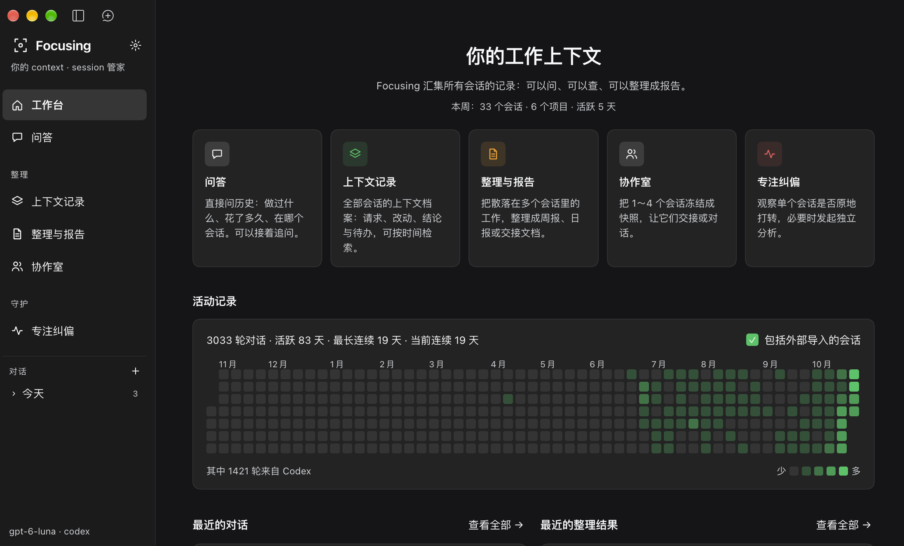
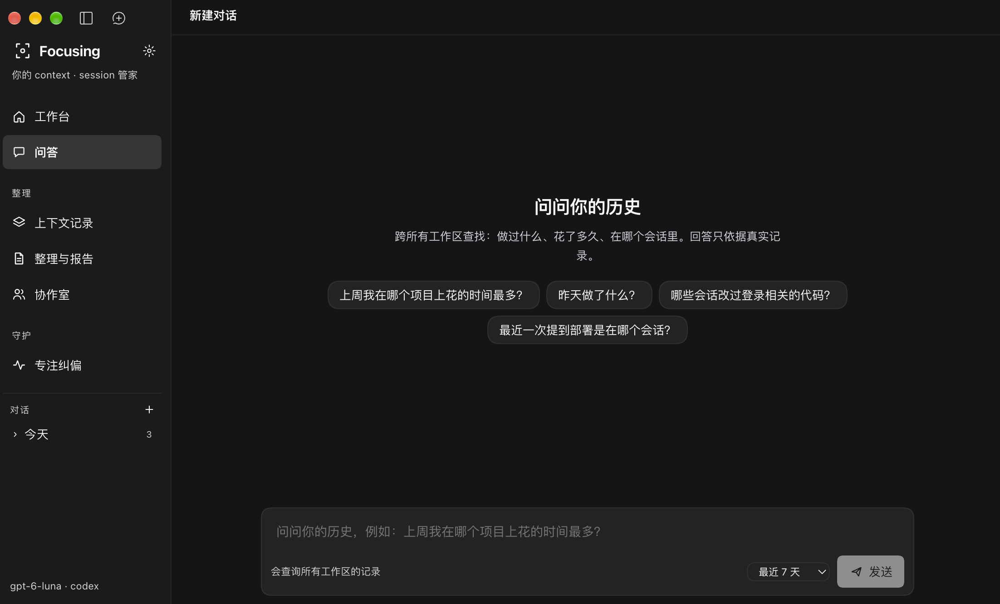
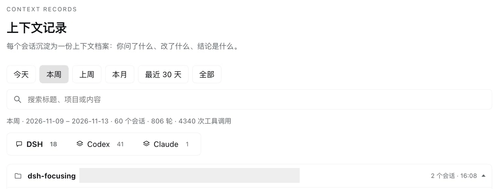

# Focusing

[](https://www.npmjs.com/package/dsh-focusing) [](https://github.com/topics/dsh-plugin)

**你的 context · session 管家。**

Focusing 是 DeepSeek Harness（DSH）的上下文工作台，把 DSH 会话和本机 Codex、Claude Code 记录汇集起来：查找过去的工作、整理日报与交接、让不同会话的经验参与讨论，以及观察 Agent 是否陷入重复尝试。

## 0.2.1 开发版（尚未发布）

- **设置页布局**：标签栏保留高度和上下留白，内容较多时由内容区滚动。
- **工作区映射**：外部记录通过目录注册接口取得真实工作区 ID，已有工作区复用，未注册目录自动注册。
- **交接到新会话**：从 DSH、Codex 或 Claude Code 记录生成交接文档，检查后放入来源目录的新 DSH 会话草稿，由用户确认发送。
- **草稿保护**：明确创建新会话，等待加载成功后写入交接内容；不覆盖已有草稿，失败显示原因。
- **历史顾问**：单会话交接可保留只读历史快照，绑定新会话；主 Agent 遇到历史疑问时，按需创建或恢复 DSH 原生子 Agent 查证。
- **Codex 审批记录过滤**：按来源标记排除 Guardian 自动审批会话，不作为独立会话展示或计入活动；旧索引自动重建，正常同名会话保留。

### 0.2.0

- **Claude Code 导入**：独立开启数据来源，自动发现会话目录；历史记录可用于问答、报告、活动统计与专注分析。
- **统一上下文记录**：按 DSH / Codex / Claude 来源和工作区浏览，复用持久索引；DSH 会话支持复制上下文继续。
- **可选界面增强**：侧栏字号、顶部会话标签、运行中／待批准状态与后台完成提示。
- **Claude 索引修复**：排除子代理日志，避免同 ID 记录掩盖主会话，并自动重建旧缓存。

[安装与开始使用](#安装升级与开始使用) · [完整更新记录](CHANGELOG.md) · [外部会话交接](#外部会话交接到-dsh)

## 从哪里开始

| 你想做什么 | 打开哪个页面 |
|---|---|
| 看最近在做哪些项目、回到已有问答或报告 | **首页**（点击左上角 Focusing） |
| 问“上周做了什么”“某个问题最后怎么解决的” | **问答** |
| 按工作区和来源浏览会话，接着之前的上下文继续，生成或重新打开交接文档 | **上下文记录** |
| 生成周报、日报，保存自己的报告模板 | **整理与报告** |
| 按重要与紧急程度安排个人任务、跟踪进度 | **四象限待办** |
| 对照几个会话的经验，讨论后生成交接简报 | **协作室** |
| 检查一个会话是否原地打转、查看分析记录 | **专注纠偏** |

## 首页：先看全局，再进入具体工作



点击侧栏左上角的 **Focusing** 回到首页。首页显示本周会话与项目概览、活动日历，以及最近的问答和整理结果，点击最近记录可以继续之前的工作。各功能入口都在左侧导航里。截图拍摄于旧版，当时首页还有一排功能卡片，现已移除。

活动日历每格代表一天，颜色深浅表示对话轮次。总轮次、活跃天数和连续活跃情况由日志计算；开启“包括外部导入的会话”后可计入已启用的 Codex、Claude Code 记录，并分别显示其贡献。上方的本周概览与日历可能覆盖不同时间窗口。

截图中的计数是示例数据。对话轮次、工具调用量反映活动量，不能直接换算成实际工时或生产力评分。

## 问答：找到历史，再接着问



在独立问答页直接输入问题，例如：

- “昨天做了什么？”
- “哪些会话改过登录相关的代码？”
- “最近一次提到部署是在哪个会话？”
- “比较两个项目处理 UI 问题的经验。”

每个新问答对应一个原生 DSH 会话。模型可以查询历史会话、读取原文或统计活动，工具调用可以展开查看。追问沿用原会话的上下文，例如请它把刚找到的原文整理成指南，可以直接用已取得的证据回答。

**搜索范围**可选“最近 7 天”“最近 30 天”和“全部记录”，默认最近 30 天。时间范围和标签在会话创建时确定。要切换范围，从左侧点击 `+` 新建对话。

对话内容居中，输入框固定在底部。左侧“对话”按今天、昨天、更早分组，可折叠、展开更多记录，或点击 `+` 新建。窄布局下改用页内下拉框切换。

原生问答支持停止和归档，消息由 DSH 保存。旧版问答仍可查看或删除，继续提问时请新建原生问答。

## 整理与报告：把工作变成可复用的文档


报告页将**模板**和**历史结果**放在一起。先选择模板与时间范围，再点击“生成”；完成后从历史列表打开、复制 Markdown、下载、追问或重新生成。

| 模板 | 产出 | 使用方式 |
|---|---|---|
| 周报 | 本周主线、各项目实际改动与验证、遗留问题、优先级明确的下一步 | 直接生成，默认本周范围 |
| 日报 | 今日成果、进行中与阻塞事项、关键文件与验证、明日优先事项 | 直接生成，默认今天范围 |
| 自定义模板 | 由自己的指令定义整理重点 | 保存名称、指令与默认范围，可编辑或删除 |

内置模板只读。自定义模板保存的是整理指令和范围。会话交接不属于周期报告模板：在「上下文记录」展开具体会话后生成，已有交接文档也在记录页底部重新打开。协作室在侧栏有独立的「协作」分组。

新建周报、日报和自定义范围报告会创建一个原生 DSH 会话：首条消息由模板和固定查证提示组成，模型通过会话内的 `focus_list_sessions`、`focus_read_session` 和 `focus_activity` 按需获取历史，不再经过插件自己的分批提炼与汇总管线。

报告页直接展示原生消息和工具调用。生成期间可以停止，完成后可以在同一会话追问；消息与工具结果由 DSH 会话日志保存。复制和下载使用最后一份完整的 Markdown 报告。时间范围与标签固定在会话创建时，重新生成会创建新会话。

旧版报告仍可查看、复制、下载和按原逻辑续跑；单会话交接暂时保留原有快照、草稿和历史顾问入口。原生会话的性能与完整性仍取决于所选模型及其工具调用，页面自动化测试不代替真实模型验收。

## 四象限待办：安排个人任务

在 Focusing 导航中打开「四象限待办」，按重要／紧急程度管理当前配置下共用的一份任务清单，不随会话切换。页面是一张「紧急 × 重要」矩阵，四个象限分别为：立即处理（重要且紧急）、计划推进（重要不紧急）、尽量委托（紧急不重要）、减少或搁置（不重要不紧急）。

在象限顶部的输入框里写下任务、按回车就能添加；保存失败时输入的文字会保留。需要填写说明、项目和截止日期时，用页头的「快速添加」或任务上的「编辑」，编辑时可调整象限。状态独立记录为待办、进行中或已完成；完成任务默认收起，可以查看并恢复。截止日期用于提示，不会自动改变象限，也不会创建提醒或调用模型。

数据保存到当前 DSH 配置目录的 `dsh-focusing.todos.json`，与会话记录、模型生成的待办和整理报告分开。保存采用私有文件权限和原子替换；并发修改同一任务时提示冲突，防止旧页面覆盖新状态。重启后仍保留，可以单独备份此文件。桌面默认配置的路径通常为 `~/.dsh/profiles/desktop/dsh-focusing.todos.json`，实际以 `DSH_PROFILE_DIR` 为准。

## 协作室：让不同会话的经验参与同一场讨论


图中把 Focusing 与 NetHack 两个项目的会话放进协作室，交流插件构建和 UI 开发经验。

创建协作室时选取 1～4 个 DSH 会话，插件将请求、结论、文件、命令和待办冻结为快照。每位参与者可使用不同模型；也可把同一会话加入两次，比较不同模型对相同材料的看法。

1. **提出议题**：以主持人身份输入问题或补充背景。
2. **点名讨论**：让某位参与者发言，或让参与者轮流一轮。每次发言根据各自快照和讨论内容生成。
3. **核对新进展**：参与者卡片显示快照时间和此后的源会话活动。图中 A 已有新动作、B 没有；点击“重新快照”可纳入最新材料。
4. **形成交接**：生成讨论简报，放入新会话输入框，检查后发送。

协作室是插件保存的独立讨论记录。参与者由“快照 + 模型”组成，发言不唤醒原 Agent，也不执行工具或修改原会话。当前选取入口仅支持 DSH 会话。

## 上下文记录与专注纠偏

### 上下文记录：按工作区回到材料，接着继续



截图保留筛选区与工作区标题，个人目录已遮挡；截图来自 0.2.0，交接入口以当前版本为准。

顶部是时间跨度（今天、本周、上周、本月、最近 30 天、**全部**）和关键词搜索，其下用 **DSH / Codex / Claude** 切换来源（各自显示会话数）；再往下每个**工作区一条横栏**，标出目录名、完整路径、会话数和最近活动，点开横栏列出该目录下的会话，点会话展开请求、阶段结论、识别到的文件改动和待办。记录卡片只标 `DSH`、`Codex` 或 `Claude` 来源，不再堆叠工作区标签。

- **DSH 会话**提供「继续上下文对话」：由 Host 复制该会话并打开副本，原会话不动，新会话保留全部上下文。
- **Codex、Claude Code 会话**只读；「在此目录新建 DSH 会话」创建同目录的空白会话，不带入历史。
- **生成交接文档**适用于 DSH 与已启用的导入来源；检查文档后可放入新 DSH 会话草稿。

#### 外部会话交接到 DSH

1. 打开「上下文记录」，切换到 Codex 或 Claude，展开目标会话。
2. 点击「生成交接文档」。文档覆盖整个来源会话，包含目标、完成结果、关键决策、文件、验证与下一步。
3. 检查生成结果，再点击「带历史顾问继续（草稿）」。若只需要交接文档，也可选择「放入新 DSH 会话草稿」。已保存的单会话交接文档同样可用。
4. Focusing 通过来源目录取得 DSH 工作区 ID，创建新会话并准备交接草稿。按需修改内容后，由你发送。
5. 使用历史顾问时，主 Agent 可调用 `focus_history_advisor` 询问过去的决策、尝试和验证结果。第一次询问才启动顾问，后续问题沿用同一子 Agent；回答通过 DSH 原生完成通知送达。

对话顶部的「对话 / 轨迹」旁新增「链接快照」。这里可以查看当前会话的关联资料、从 DSH／Codex／Claude 会话添加其他来源，以及点击「更新快照」采集该来源的最新历史。添加来源不改变当前工作目录，也不自动发送消息或调用模型。更新生成新版本并切换当前引用，旧版本仍可通过版本选择器分页查看；并发更新冲突时会提示重新核对。旧单快照绑定自动兼容为第一条来源。

「链接快照」后还有「已配置 Skills」标签。它通过 DSH 官方会话 Skills 接口显示当前会话可手动调用的技能，支持搜索，点击名称展开用途、适用场景及 `/技能名 任务内容` 的使用方法。界面区分“模型也可按需使用”和“仅由用户主动调用”；只有模型可调用、用户不能手动调用的技能不在这个官方目录中。查看不会执行技能、发送消息、加载技能正文或调用模型；缺少会话权限或接口时明确显示错误。切换会话、切换预设、插件变更和重连会重新读取，也可手动刷新。

主 Agent 的运行时上下文会提示当前关联的来源和版本；顾问每次查询重新读取关联，区分新旧证据。历史顾问只开放列举、读取和搜索已关联快照版本的工具，不能执行命令、修改文件或访问未关联的会话。快照保存普通对话文本、工具调用与结果及回合状态，分片提供原文和引用位置；不导入外部运行时指令、隐藏推理或 provider replay 状态。初始交接最多保留 10,000 字符，缩短时明确标注，顾问仍可查询快照原文。

快照在点击接续时固定，报告的生成时间另行标明，两者可能不同。原会话之后的变化不会自动同步，点击「更新快照」才会采集新版本；历史材料也不能证明当前文件仍相同。更新不会把旧交接摘要当成重新生成的总结。快照和会话关联持久保存，顾问的运行、消息和冷恢复由 DSH 管理；预设不可用或数据损坏时停止并报告错误，不降级成有写权限的普通 Agent。单个快照上限 32 MiB，超过时明确拒绝。本版尚未提供快照清理界面。

工作区路径由 DSH 规范化，已有注册会复用，尚未注册的现有目录会注册为工作区；不会创建磁盘目录。缺少目录、目录不可访问、来源记录不可读取或 DSH 接口不可用时显示错误，文档仍可复制、下载。不会退回当前工作区，以免把任务放到错误目录。

模型不可用时生成的结构草稿保留原有提示，放入新会话的也是这份草稿。不会恢复 Codex／Claude 原生会话，也不进行完整历史迁移。新会话创建后若加载或草稿初始化失败，可能留下空白会话；已有草稿不会被覆盖。

列表由持久索引驱动：每个会话只整理一次，文件没变就直接复用，重启后不再重扫全部记录；范围统计仍只计算所选时间跨度内的轮次。需要核对更长的消息或工具输出时，历史问答可以读取原始事件。

### 专注纠偏：观察重复尝试，按需分析

<!-- 截图预留：专注纠偏结果与分析历史，docs/images/focus-review.webp。 -->

专注纠偏提供单会话活动观察、手动模型分析和分析历史。确定性检测器关注重复错误、重复调用和缺少进展；步数预算只作为辅助信号，不单独触发干预。

自动干预有软提示、重复调用拦截和子代理诊断三种，默认关闭，可在插件配置中启用。手动分析支持 DSH 历史会话和导入的 Codex、Claude Code 会话，结果可保存回看；DSH 会话还会提示分析之后是否有新活动。

Codex、Claude Code 导入均为只读，分析结果留在 Focusing，不会控制原工具或向原会话注入纠偏消息。协作室当前仍只选择 DSH 会话。

## 可选界面调节


顶部截图中的其他会话标题已遮挡；当前标签与原生操作布局保留。

在 **Focusing → 设置 → 界面** 中分别勾选并保存，两个功能默认都关闭：

- **调整左侧栏字号**：12–20 px，调整左侧会话、项目、导航以及相关次级文字；取消勾选移除覆盖样式，恢复 DSH 原样。
- **顶部会话标签栏**：打开主会话时添加标签，支持横向滚动和快速切换；当前标签用蓝色下划线标识。关闭标签不删除或归档会话，关闭最后一个标签返回 Focusing。
- **会话状态**：标签显示“运行中”或“待批准”；观察到后台任务完成后显示未读绿点，打开查看后清除。

开关与字号保存在 Focusing 设置中；标签列表与未读状态保存在当前浏览器，刷新后恢复。顶部 Focusing 图标用于进入工作台，在工作台中则显示“返回会话”。

界面适配针对 DSH 0.2.2-rc 系列的页面结构，升级 DSH 后需复核；关闭对应开关可恢复原生布局。

<details>
<summary>独立网页（已封存，开发参考）</summary>

独立浏览器服务暂不启用。以下保留实现与启动说明，重新启用前需完成接入及权限验证。

<!-- 功能恢复并完成验收后再补截图： -->

网页直接加载与 DSH 插件相同的 [Workbench](lib/client.js)，共用导航、记录页、设置对话框和样式。纯本地运行时读取 Codex、Claude Code 日志，支持外部模型分析和报告；DSH 桥接模式接入原生会话、Host 模型、历史问答和协作室，使用 DSH 已注册的业务接口。

```bash
# 在仓库中启动，默认监听 http://127.0.0.1:8765
node lib/standalone.mjs

# 选择空闲端口，启动后打印实际 URL
node lib/standalone.mjs --port 0

# 指定独立数据目录
FOCUSING_DATA_DIR=/tmp/focusing-demo node lib/standalone.mjs --port 0
```

作为 npm 包安装后，也可运行 `focusing serve`。打开命令输出的 `FOCUSING_URL`，在顶栏设置的来源页开启 Claude Code 或 Codex 导入。页面支持：

- 来源开关、自动/手动目录、索引状态和错误提示。
- 按时间、来源、项目、工作区及关键词筛选记录；展开查看会话详情。
- 活动日历、手动分析、Markdown/JSON 导出、报告模板和报告追问。
- 外部模型设置、连接测试及模型目录读取。

会话 Tag 使用稳定 ID：`source:claude`、`project:项目名`、`workspace:完整路径`。多个 Tag 按 AND 匹配；同名项目可通过工作区完整路径区分。范围问答会把所选 Tag 绑定到历史读取工具，继续追问也沿用该范围。

纯本地模式没有 DSH 服务连接时，页面按实际能力隐藏 DSH 问答、协作室及原会话操作。桥接模式复用 DSH 中现有的会话、模型、问答历史、报告、分析和协作室；当前网页桥接尚未支持打开原会话、复制后跳转及未发送草稿，这些操作依赖 DSH Client 导航。

在 DSH 中可让 Agent 调用 `focusing_web`：`action: "start"` 启动桥接并返回私有访问 URL，`status` 查看状态，`stop` 关闭监听且保留所有历史。首次打开 URL 后会跳转到不含凭证的地址，并使用 HttpOnly、SameSite=Strict cookie。重启桥接会生成新的凭证；不要公开分享首次访问链接。该工具与已鉴权 DSH 域下的 `/api/dsh-focusing.bridge` 启停接口调用相同操作，默认不会自动开启监听。

服务仅监听 `127.0.0.1`、`::1` 或 `localhost`，校验 Host、端口、Origin 和跨站请求，不提供局域网访问。纯本地设置与索引默认保存到 `~/.focusing`，可用 `FOCUSING_DATA_DIR` 或 `--data-dir` 修改。按 `Ctrl+C` 停止时会等待在途索引读取结束。

</details>

## 安装、升级与开始使用

**版本要求：** 0.2.1 开发版要求 DSH `>=0.2.2-rc.2 <0.3.0`，历史顾问使用该版本核查过的原生子 Agent 和预设接口。已发布的 0.2.0 仍为 `>=0.2.1-rc.3 <0.3.0`。界面增强适配说明见「可选界面调节」。

### 验证与限制

- 已发布的 0.2.0：隔离 `DSH_PROFILE_DIR` 运行全量测试，408 项通过；入口语法检查及 npm 打包预检通过。
- 0.2.1 开发版：隔离配置目录的全量测试 605 项通过，语法检查及 npm 打包预检通过。接口按 DSH 0.2.2-rc.2 核查；真实工具注册表和 native executor 的历史顾问隔离验证通过，未调用模型。草稿功能会检查所需服务，不可用时给出错误提示。
- 自动化测试不替代真实页面验收；设置页视觉效果及实际输入框交接仍需在运行页面核对。
- 独立网页服务保持封存，多 harness 编排未实现。

完整版本变更见 [更新记录](CHANGELOG.md)。

### 从 npm 快速安装

npm 包名是 **`dsh-focusing`**。在 DSH 打开 **插件 → 添加插件**，搜索或输入：

```text
dsh-focusing
```

也可指定版本安装：

```text
dsh-focusing@0.2.0
```

如果所用 registry 尚未提供该版本，可按下方方法从本地发布包安装。批准安装并启用 **Focusing**，按 DSH 的提示刷新页面或重启。

### 从本地仓库安装

克隆仓库后，在 DSH 会话中要求使用插件管理器安装该仓库的绝对路径。也可以在仓库根目录执行：

```bash
npm pack
```

当前开发分支生成 `dsh-focusing-0.2.1.tgz` 后，通过 DSH 插件管理器安装该文件（npm 已发布版本仍为 0.2.0）。不要手动修改 DSH profile 的 `package.json` 或 patch 文件，也不要把仓库手工链接进 profile。

升级前可备份当前 profile 中的 `dsh-focusing.*.json` 数据文件。替换已安装版本通常需要完整重启才能加载新的 Host 模块。

1. 安装并启用插件后，从侧栏打开 **Focusing**。入口及默认配置声明在 `package.json` 和 `cordis.patch.yml`。
2. 点击导航顶部的设置齿轮，在“模型与连接”中选择 DSH 已配置模型，或配置外部 OpenAI 兼容接口。
3. 如需纳入 Codex，在“来源”中开启导入。可自动查找 `CODEX_HOME`、`~/.codex`，或手动指定目录。初次索引可能需要等待。
4. 如需纳入 Claude Code，单独开启 Claude 导入。自动发现依次查找 `CLAUDE_CONFIG_DIR` 和 `~/.claude`，读取其中的 `projects/**/*.jsonl`；也可手动填写配置目录或 `projects` 目录。这里导入的是本机会话记录，不是 Anthropic API 或模型供应商配置。
5. 到问答页选择搜索范围并提问；需要固定格式输出时，到整理与报告选择模板。

| 功能 | 模型来源 |
|---|---|
| 历史问答 | 原生 DSH 会话的模型，需要工具调用能力 |
| 报告、报告追问、专注分析 | 插件模型设置：DSH 模型或外部 OpenAI 兼容接口 |
| 协作室 | 默认跟随插件设置，也可为参与者单独选择模型 |
| 接续会话的历史顾问 | DSH 原生子 Agent 使用的模型，需要工具调用能力；不使用报告的外部接口循环 |

插件模型设置不替换普通 DSH 聊天选择的模型。保存设置不会自动分析内容；连接测试只发送探测文本。专注分析可预览将发送的提示词与材料，API Key 留在 Host，页面只收到是否已配置的标记。

模型 id 可能本身带斜杠（如 `copilot/auto`），选择器按第一个斜杠拆分，不会截断。已保存但供应商不再提供的模型会在启动、打开模型列表或保存设置时自动修复：能唯一补全的就补全，否则清空该选项、回落到「跟随 DSH 当前默认模型」，避免每次调用都报 `UNKNOWN_MODEL`。

<!-- 截图预留：Codex / Claude 来源开关、目录与索引状态，docs/images/source-settings.webp。 -->

## 查询机制与当前边界

历史问答使用原生 DSH Agent 和会话。Focusing 将以下只读工具注册在该 Agent 的作用域内，并限制此会话只能执行这三项工具。它们与报告共用历史记录读取层。

| 内部工具 | 返回什么 |
|---|---|
| `focus_list_sessions` | 按关键词检索原始消息、工具调用和工具输出，返回按相关性排序的会话、命中片段及所在事件 |
| `focus_read_session` | 按会话 ID 读取原始事件，也可从指定的命中事件开始 |
| `focus_activity` | 返回整个查询区间的轮次、工具调用和会话总数，以及分页的每日明细 |

- 查询支持中文分词、多个关键词和短语匹配。可用时间、来源、项目和工作区缩小范围。源日志读取失败时，会返回可用结果并提示覆盖不完整。
- 工具按 12,000 字符预算划分完整的 JSON 页。原始事件分片按 `eventIndex` 和 `offset` 拼接，通过 `nextCursor` 继续读取。底层记录变化后，可能需要重新查询。
- DSH 原生 Agent 管理对话和工具调用。需要查证新事实时查询历史，同范围内的总结或改写可以复用前文。
- 问答使用浏览器时区和创建时选定的窗口。报告使用今天、昨天、本周、上周、本月、最近 7 天和最近 30 天等固定范围。
- **统计不等于完整审计**：大范围报告会压缩上下文；文件、失败和命令提取依赖事件格式。活动量不能直接表示工时。
- **历史时区使用固定偏移**：不是 IANA 时区，跨夏令时切换的时间范围需要核对。查询采用 `[start, end)`，包含开始、不包含结束；活动查询单次最多 366 天。

原始会话从 DSH 服务、本机 Codex rollout 或 Claude Code JSONL 只读获取。发起问答、报告、分析和协作讨论时，相关材料会发送到所选模型服务。历史消息及工具输出作为资料处理，不能被当作新的执行指令。

<details>
<summary>本地存储与开发入口</summary>

存储目录优先使用 `DSH_PROFILE_DIR`，其次 `DSH_HOME`，否则使用 Host 当前工作目录。

| 文件 | 内容 |
|---|---|
| `dsh-focusing.analysis.json` | 模型、连接和来源设置 |
| `dsh-focusing.todos.json` | 独立个人四象限任务与进度 |
| `dsh-focusing.digests.json` | 整理报告与分批生成检查点 |
| `dsh-focusing.digests.json.snapshots/` | 整理所选范围的不可变摘录快照；暂不自动清理 |
| `dsh-focusing.digests.json.templates.json` | 自定义报告模板，最多 50 个 |
| `dsh-focusing.digests.json.asks.json` | 旧版问答记录 |
| `dsh-focusing.digests.json.native-sessions.json` | 原生问答的会话 ID、查询范围和归档状态，消息存于 DSH 会话日志 |
| `dsh-focusing.rooms.json` | 协作室快照、讨论与简报 |
| `dsh-focusing.history/` | 不可变历史快照、SHA-256 校验与主会话／顾问关联；顾问对话另由 DSH Session 保存 |
| `dsh-focusing.reviews.json` | 单会话分析历史 |
| `dsh-focusing.codex-index.json` | Codex 索引缓存 |
| `dsh-focusing.claude-index.json` | Claude Code 索引缓存 |
| `dsh-focusing.activity-index.json` | 活动日历的每日时间线缓存（只含计数与时间，不含对话文本） |
| `dsh-focusing.records-index.json` | 上下文记录的持久索引（每个会话的列表行，按文件修订增量更新） |

### 核心层与宿主边界

来源、查询和模型模块可以在没有 Cordis、HTTP 或 DSH 服务查找的情况下实例化。DSH 插件和独立本地服务共用这些模块与 Workbench；桥接模式转发到已有的 DSH 业务处理器，避免另建一套会话和设置存储。

- `imported-runtime.mjs` 管理导入来源的目录、索引、状态、详情和后台读取生命周期；目录切换会退休旧 reader 并纳入清理等待，日历排除外部来源时只做轻量状态检查。
- `context-service.mjs` 提供记录列表、详情、活动统计和报告取材，不处理 HTTP 协议。
- `model-gateway.mjs` 统一报告、追问、协作室、专注分析和连接测试的一次性模型调用；Host 模型与外部 OpenAI 兼容接口都是注入的驱动。
- 原生 DSH 问答 Agent、会话复制/归档、实时干预和 UI Slot 仍属于 Host 适配层。

| 模块 | 代码入口 |
|---|---|
| Host / UI | `lib/index.mjs`、`lib/client.js` |
| 读取、折叠、索引 | `lib/context-source.mjs`、`lib/context-records.mjs`、`lib/record-index.mjs`、`lib/transcript-index.mjs` |
| 来源运行时 | `lib/imported-runtime.mjs` |
| 上下文查询 | `lib/context-service.mjs` |
| 一次性模型网关 | `lib/model-gateway.mjs` |
| 独立应用与服务 | `lib/standalone-app.mjs`、`lib/standalone-server.mjs`、`lib/standalone.mjs` |
| 共享网页入口 | [index.html](web/index.html)、[standalone-shell.js](web/standalone-shell.js)、[theme.css](web/theme.css) |
| DSH 桥接 | [dsh-bridge.mjs](lib/dsh-bridge.mjs) |
| Codex 导入 | `lib/codex-rollout.mjs`、`lib/codex-index.mjs` |
| Claude Code 导入 | `lib/claude-code.mjs` |
| 历史问答 | `lib/ask.mjs`、`lib/ask-store.mjs`、`lib/context-tools.mjs`、`lib/native-ask-routes.mjs`、`lib/focusing-session-store.mjs` |
| 历史顾问 | [history-advisor.mjs](lib/history-advisor.mjs)、[history-store.mjs](lib/history-store.mjs)、[history-advisor-policy.mjs](lib/history-advisor-policy.mjs) |
| 模板与报告 | `lib/template-store.mjs`、`lib/digest.mjs`、`lib/digest-store.mjs`、`lib/context-routes.mjs` |
| 活动与时间 | `lib/activity.mjs`、`lib/time-range.mjs` |
| 协作室 | `lib/room.mjs`、`lib/room-routes.mjs` |
| 检测与分析 | `lib/detector.mjs`、`lib/correction.mjs`、`lib/review.mjs`、`lib/review-store.mjs` |

```bash
# 隔离测试状态
DSH_PROFILE_DIR="$(mktemp -d)" node --test

# 检查入口语法
node --check lib/index.mjs
node --check lib/client.js
```

自动化测试覆盖记录、路由、模型响应处理和客户端交互逻辑。历史顾问还提供 [原生运行时隔离验证脚本](scripts/verify-history-advisor-runtime.mjs)，以已安装 DSH 的包目录作为第一个参数；Desktop 使用 `ELECTRON_RUN_AS_NODE=1 "$DSH_NODE_EXECUTABLE"` 执行。该脚本使用真实工具注册表、scope 和 native executor，在临时目录验证只读边界，不调用模型。真实 Host 中的渲染、服务连接及模型回答仍需实际验证。

</details>

截图展示工作台、独立问答、模板报告、协作室、上下文筛选、界面设置和顶部会话标签，包含浅色与深色界面。图片以无损 WebP 保存；新增展示图按功能区域裁剪，部分个人路径与会话标题已遮挡。截图中的名称、计数和时间仅代表拍摄时的状态。
